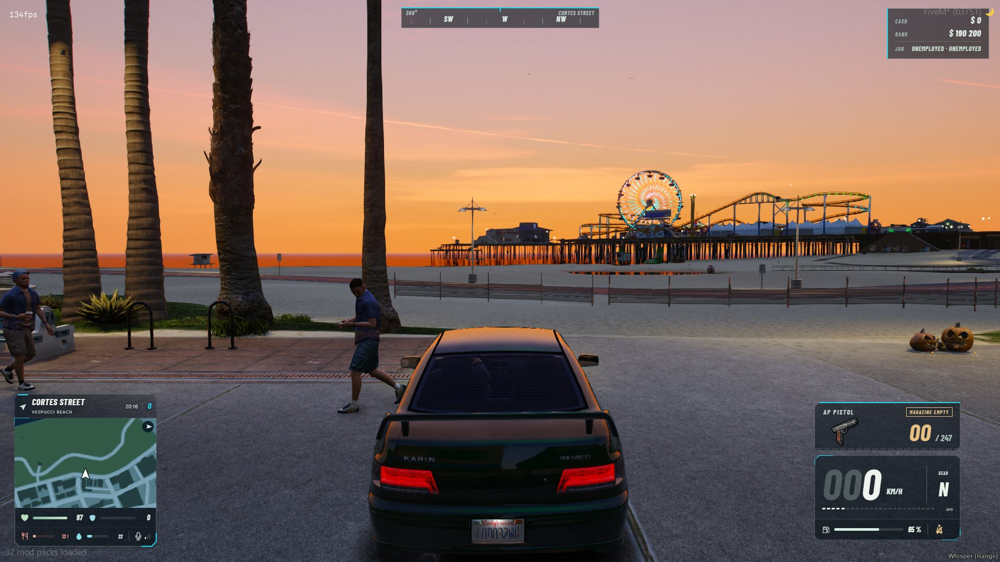
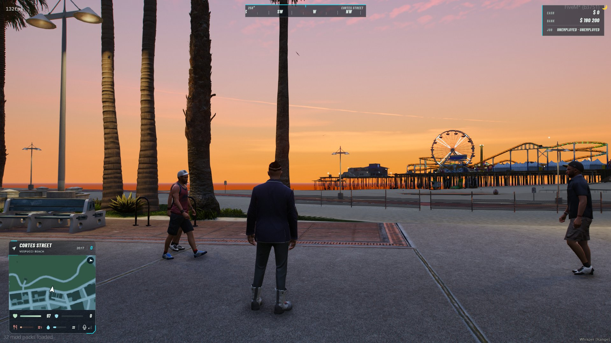
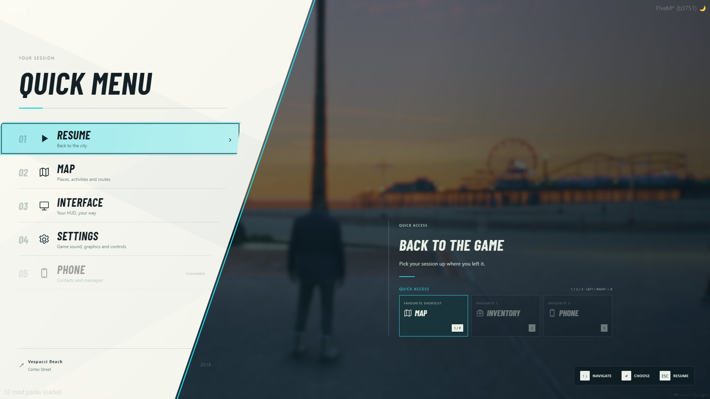
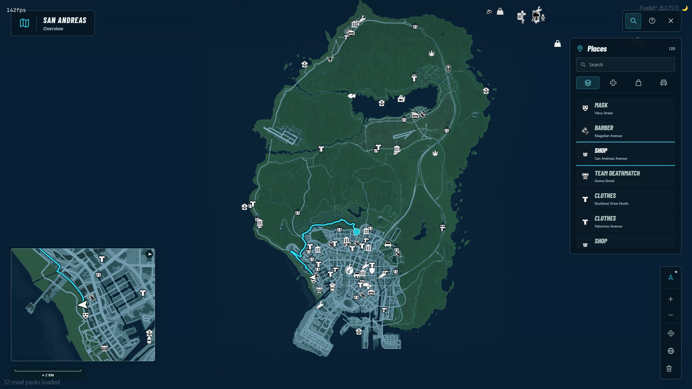
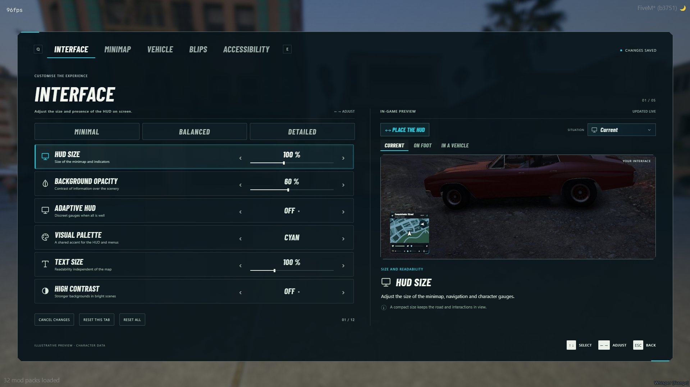
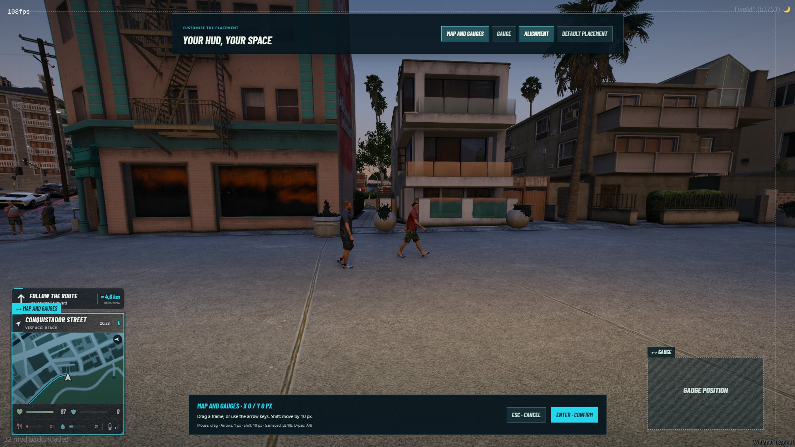

# vanta_hud

A standalone roleplay HUD for FiveM: health, hunger, thirst, voice, vehicle gauge, custom minimap with GPS, quick menu, compass, cash/job and a weapon HUD. Everything is adjustable in game, no file editing needed. Available in English and French (`Config.Locale`).

## Screenshots








## Features

- Minimap and full-screen map rendered in WebGL (local atlas), custom blips, GPS on foot and in vehicles. One click sets the waypoint.
- Vehicle gauge (speed, gear, RPM, fuel, seatbelt) and alerts: fuel, engine, body, burst tyre.
- Health, armour, hunger, thirst, stamina, oxygen, voice and radio.
- Compass (heading, cardinal points, street), cash and job (when your server provides them, see *For developers*).
- Weapon HUD: name, icon, magazine, reserve, state (reloading, empty magazine). The native ammo counter is hidden.
- Quick menu (replaces Esc/P): map, interface, GTA settings, favourite shortcuts, 3 interface profiles.
- Drag-and-drop placement editor, themes, scale, opacity, cinema mode.

## Requirements

None. The resource depends on no other resource: no ESX, no QBCore, no inventory, no phone.

Hunger/thirst and cash/job are optional. Pick your framework in `Config.Framework` (`'standalone'` by default, `'esx'`, `'qb'` for QBCore/QBox, or `'auto'`) and the HUD reads them by itself; the adapter never modifies the framework. Without a framework these elements stay hidden unless you call the `SetNeeds` / `SetEconomy` exports. The Inventory/Phone shortcuts of the menu are disabled by default (`Config.Integrations`).

## Installation

1. Copy the `vanta_hud` folder into `resources/`.
2. Add `ensure vanta_hud` to `server.cfg`.
3. Restart the server.

After an update: `refresh`, then `restart vanta_hud`.

`stream/minimap.gfx` (blip symbols on the native minimap) is not included in the repository: it is a modified GTA file. The HUD, its map and its blips work without it; you just keep the vanilla symbols on the native radar. If you add it to `stream/`, players must reconnect for it to apply.

## Language

Set `Config.Locale` in `config.lua` to `'en'` (default) or `'fr'`. It translates the interface and the in-game messages. To add a language, copy `locales/fr.lua` and `web/locales/fr.js`, translate the values, and load the web file from `web/index.html` next to `locales/fr.js`. Texts missing from a language file simply stay in English.

## Usage

| Command / key | Effect |
|---|---|
| `F1` (rebindable in GTA Settings > Key Bindings > FiveM) | Quick menu |
| Esc or `P` | Also opens the quick menu (`Config.ReplacePauseMenu`) |
| `/vanta_hud` | Hide / show the HUD |
| `/hudcinema` | Cinema mode (bindable key: "HUD: cinema mode") |
| `/hudprofile save 1-3`, `/hudprofile load 1-3`, `/hudprofile list` | Interface profiles |
| `/vanta_hud_reset` | Reset the settings |
| `/hudgps`, `/hudperf` | Diagnostics in the F8 console |

## Configuration

Everything is in `config.lua`: language, menu key, seatbelt (`Config.Seatbelt`, built in by default or read from another resource), framework adapter (`Config.Framework`), menu shortcuts (`Config.Integrations`), weapon labels (`Config.WeaponLabels`), alert thresholds (`Config.VehicleWarnings`), update rates (`Config.UpdateMs`, `Config.VehicleUpdateMs`), default settings (`Config.Defaults`). Each player's preferences are stored client-side.

## For developers

Client exports: `SetVisible(bool)`, `VantaHudHidden(bool)`, `VantaStatusHidden(bool)`, `SetCinema(bool)`, `Notify({ message, title, kind, duration })`, `SetMicrophoneMuted(bool)`, `SetNeeds(hunger, thirst)` (percentages 0-100, `nil` hides the gauge), `SetEconomy({ cash, bank, job, grade })` (`nil` hides the block).

Example for a framework without an adapter, client side:

```lua
exports.vanta_hud:SetNeeds(hunger, thirst)
exports.vanta_hud:SetEconomy({ cash = 1200, bank = 8000, job = 'Police', grade = 'Sergeant' })
```

Documentation: `CHANGELOG.md`, `PERFORMANCE.md`, `MAP2D.md`.

## Known limitations

- ESX adapter: taken from code that ran on ESX Legacy. QBCore/QBox adapter: written from the public API, not validated in game yet. Other frameworks: use the `SetNeeds` / `SetEconomy` exports.
- Standalone mode, the adapters and the language option have not been validated in game since version 1.11.
- Performance figures (resmon) depend on the server and are not guaranteed.

## Licences

Original code and icons: MIT (`LICENSE`). Barlow Condensed font: SIL OFL. Rockstar Games elements (minimap, blips) remain with their rights holders. The weapon icons (`web/weapons`) come from **ox_inventory** (Overextended, GPL-3.0 or later); the images depict GTA V weapons (Rockstar Games). Details and provenance: `THIRD_PARTY.md` and `licenses/`.
